<p align="center">
  
</p>

<p align="center">
  <a href="https://github.com/syedtaj7/sift/releases/latest/download/Sift.exe"></a>
</p>

<p align="center">
  <a href="https://github.com/syedtaj7/sift/releases/latest"></a>
  
  
  <a href="LICENSE"></a>
</p>

<p align="center"><b>Sift</b> opens your Google Takeout zips one at a time (or any folder of photos) and keeps <b>only your travel photos and videos</b>,<br>filed by region and city. Selfies, home shots, WhatsApp forwards and screenshots stay in Google Photos.</p>


| | Step | What happens |
|:-:|---|---|
| **1** | **Export** | Ask [Google Takeout](https://takeout.google.com) for Google Photos and download the first zip. |
| **2** | **Sift it** | Open Sift, pick the zip, press **Find my trips**. Every photo is checked and flies into its folder. |
| **3** | **Keep the trips** | They land in `Pictures\Sift Trips\Kashmir\Srinagar` and so on. Delete the zip, load the next. |

Takeout splits a big library into many zips. Sift works through them one by one and remembers what it already kept, so you never need space for all of it at once. **Photos mode** sorts any ordinary folder (and its subfolders) the same way.




- **People**: selfies, group shots and close-up faces, found by an on-device face detector
- **Home**: anything taken within the radius you set around your home city
- **WhatsApp**: forwards and other images that came from someone else
- **Screens**: screenshots, plus shots too blurry or dark to use in a reel
- **No GPS**: no location, and no nearby photo to borrow one from
- **Duplicates**: Takeout copies album photos twice; Sift keeps one

Nothing is deleted or moved. Everything Sift leaves out is only counted and stays where it was.




Old phones guess. Sift checks every photo against the ones taken just before and after it. A photo 1,400 km away from both neighbours, half an hour apart, is a bad reading and gets the neighbours' place. Photos with no GPS borrow a place from shots taken within 3 hours.


1. **Download** [`Sift.exe`](https://github.com/syedtaj7/sift/releases/latest/download/Sift.exe) (Windows 10 or 11, 64-bit).
2. **Double-click it.** Sift offers to install itself with a Desktop and Start menu shortcut.
3. **Set your home city** once, then pick your first zip.

> [!NOTE]
> Sift isn't signed with a paid certificate yet, so Windows may show **Windows protected your PC**. Click **More info**, then **Run anyway**. You only need to do this once.

Every [release](https://github.com/syedtaj7/sift/releases/latest) lists the SHA-256 fingerprint of `Sift.exe`. Check your copy in PowerShell:

```powershell
Get-FileHash .\Sift.exe -Algorithm SHA256
```


- **Nothing leaves your PC.** No accounts, no analytics, no uploads. Sift reads your zips and writes your Trips folder, that's all.
- **Originals are never changed.** The only thing Sift can delete is a Takeout zip, and only when you click **Delete zip** and confirm.
- **The local server only talks to Sift.** The app window uses a small server on `127.0.0.1:8765` that your network can't reach. It refuses requests from any other website (Host, Origin and Sec-Fetch-Site checks against DNS rebinding and cross-site requests), sends a strict Content Security Policy, and only opens folders inside your trip collection.
- **Your home city** is stored only in `%LOCALAPPDATA%\Sift\settings.json`.

Found a security problem? Please open an issue without the details and ask for a private contact.


```bat
Start Sift.bat
```

runs Sift from source (it makes a Python venv on first run). `.\build.ps1` builds `Sift.exe` with PyInstaller.

| Path | What it is |
|---|---|
| `engine.py` | Sorting: metadata, location repair, face and blur checks, extraction |
| `server.py` | Local server for the app window, with the safety checks |
| `app.py` | Desktop launcher: install, app window, auto-quit |
| `web/` | The app's pixel interface |
| `travel_places.csv` | Extra small towns and landmarks for naming trips |
| `site/`, `website/` | The download page (source and static build) |
| `docs/readme/` | This README's art, drawn by `make_art.py` |

**Hosting the download page:** `website/` is one static HTML file. On **Vercel** or **Netlify**, import this repo and deploy with the defaults: `vercel.json` and `netlify.toml` already set the folder and security headers. Edit `site/index.html`, then run `python make_website.py`.


<p align="center">
  <sub>MIT licensed · bundles open-source parts listed in <a href="THIRD_PARTY_NOTICES.md">THIRD_PARTY_NOTICES.md</a> · place names © <a href="https://www.geonames.org">GeoNames</a> (CC BY 4.0) · not affiliated with Google</sub>
</p>
